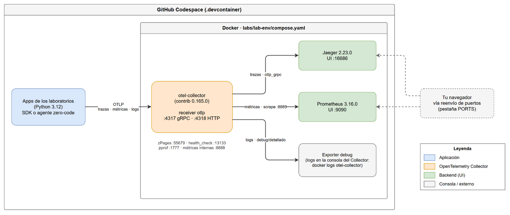

# Entrenamiento OTCA · OpenTelemetry Certified Associate

[](https://codespaces.new/JoseRomeroDT/training_otca?quickstart=1)
[](https://github.com/JoseRomeroDT/training_otca/actions/workflows/validar.yml)

Ruta de estudio para preparar en equipo la certificación **OpenTelemetry Certified Associate (OTCA)** de la CNCF / Linux Foundation: sílabo de 12 sesiones, material de estudio basado **solo en documentación oficial**, laboratorios prácticos en **GitHub Codespaces** y simulacros tipo examen, con el avance guardado en el navegador de cada persona.

**Sitio del curso:** <https://joseromerodt.github.io/training_otca/> (ver [Publicar el sitio](#publicar-el-sitio)).

## Cómo usarlo

1. Abre el sitio y empieza por **Ruta OTCA: sílabo y avance del curso**.
2. Haz el **Laboratorio 0** para crear tu Codespace (botón de arriba o *Code → Codespaces → Create codespace on main*).
3. En cada sesión: lee el material, marca las lecturas oficiales, haz el laboratorio y, al cerrar cada dominio, su quiz.
4. Termina con el **simulacro** (meta: 80 % o más) y agenda el examen.

El progreso (casillas, respuestas y mejores resultados) se guarda en el `localStorage` de tu navegador: no hay cuentas ni servidor.

## El examen

| Dato oficial | Valor |
|---|---|
| Preguntas / duración | 60 de opción múltiple / 90 minutos |
| Aprobación | 75 % |
| Formato | En línea, supervisado |
| Costo | USD 250, incluye un reintento; 12 meses para rendirlo |
| Vigencia | 2 años |

| Dominio | Peso |
|---|---|
| 1. Fundamentals of Observability | 18 % |
| 2. The OpenTelemetry API and SDK | 46 % |
| 3. The OpenTelemetry Collector | 26 % |
| 4. Maintaining and Debugging Observability Pipelines | 10 % |

Fuentes: [Linux Foundation](https://training.linuxfoundation.org/certification/opentelemetry-certified-associate-otca/), [CNCF](https://www.cncf.io/training/certification/otca/), [currículo (PDF)](https://github.com/cncf/curriculum/blob/main/OTCA_Curriculum.pdf), [FAQ](https://docs.linuxfoundation.org/tc-docs/certification/faq-mc) e [instrucciones](https://docs.linuxfoundation.org/tc-docs/certification/important-instructions-mc) de exámenes de opción múltiple.

## Sílabo

| # | Dominio | Tema | Laboratorio |
|---|---|---|---|
| 1 | 1 | Introducción a la observabilidad | Astronomy Shop (demo oficial 3.1.0) |
| 2 | 1 | Instrumentación y convenciones semánticas | Zero-code en Python |
| 3 | 2 | API vs SDK y modelo de datos | Primer span y métrica con el SDK |
| 4 | 2 | Trazas: spans, processors y sampling | Trazado distribuido de 2 servicios |
| 5 | 2 | Métricas: instrumentos y agregación | Métricas de negocio por OTLP |
| 6 | 2 | Logs, contexto y propagación | Logs correlacionados y propagación W3C |
| 7 | 2 | Configuración, OTLP y agentes zero-code | Configuración solo con `OTEL_*` |
| 8 | 3 | Collector: componentes y pipelines | Tu propio Collector |
| 9 | 3 | Connectors, OTTL y despliegue | OTTL + agent → gateway |
| 10 | 3 | Operator, Kubernetes y escalamiento | Operator en kind |
| 11 | 4 | Mantenimiento y depuración | Depurar pipelines rotos |
| 12 | Todos | Repaso y simulacro | Quizzes y simulacro |

## Entorno de laboratorio



El Codespace (`.devcontainer/`) trae Python 3.12 con un `.venv` listo, Docker, `kubectl`, Helm y `kind`. El entorno se levanta con `labs/lab-env/up.sh`. Versiones fijadas:

| Componente | Versión |
|---|---|
| OpenTelemetry Collector (contrib) | 0.165.0 |
| OpenTelemetry Python (API/SDK · instrumentaciones) | 1.45.2 · 0.66b2 |
| Jaeger | 2.23.0 |
| Prometheus | 3.16.0 |
| OpenTelemetry Demo | 3.1.0 |
| kind · cert-manager · OpenTelemetry Operator | 0.33.0 · 1.21.3 · 0.163.0 |

Más detalle en [`labs/README.md`](labs/README.md).

## Estructura

```text
documents/steps/estudio/   sílabo (ruta) y 12 sesiones de estudio   (*.procedure.steps.md)
documents/steps/labs/      12 guías de laboratorio                   (*.labguide.steps.md)
documents/tests/           quizzes por dominio y simulacro            (*.test.md)
documents/img/             diagramas draw.io: .drawio (fuente) y .drawio.png (con el diagrama embebido)
labs/                      código de los laboratorios y entorno (Collector, Jaeger, Prometheus, kind)
.devcontainer/             definición del Codespace
.github/workflows/         CI: valida documentos, configs del Collector y los labs de punta a punta
assets/, schemas/, scripts/, index.html   motor del sitio (DocPages)
```

## Publicar el sitio

Es un sitio estático, sin compilación. Una sola vez, con permisos de administrador del repositorio: **Settings → Pages → Build and deployment → Source: Deploy from a branch → `main` / `(root)` → Save**. En uno o dos minutos queda en `https://joseromerodt.github.io/training_otca/`. El repositorio debe ser público (el sitio lista los documentos con la API pública de GitHub).

## Editar o agregar contenido

- El **final del nombre** del archivo decide el tipo: `.procedure.steps.md` (material de estudio), `.labguide.steps.md` (laboratorio), `.test.md` (quiz o simulacro). El formato completo está en [`.github/skills/documentation-pages/SKILL.md`](.github/skills/documentation-pages/SKILL.md).
- Reglas del curso: contenido en español con los términos técnicos en inglés (el examen es en inglés), **cada dato con su fuente oficial** y versiones fijadas.
- Valida antes de subir (solo necesita Node 22+): `node scripts/validate-documents.mjs` y `node scripts/check-links.mjs`, o usa la pestaña **Validar** del sitio.
- Si cambias un documento de forma significativa, sube su `version` (el progreso guardado es por versión).
- Los diagramas se editan con [draw.io](https://www.drawio.com/): abre `documents/img/<nombre>.drawio` (o directamente el `.drawio.png`, que trae el diagrama embebido), edítalo y vuelve a exportar el PNG con *Embed diagram* activado.
- El CI (`.github/workflows/validar.yml`) además valida las configuraciones del Collector con `otelcol-contrib validate` y ejecuta los laboratorios de punta a punta. Los mismos scripts sirven en un Codespace: `bash .github/scripts/e2e-labs.sh`.

## Créditos

- Motor del sitio: [DocPages](https://github.com/Edunzz/docpages), de Jose Eduardo Romero Jimenez (licencia [MIT](LICENSE)); librerías de terceros en [`assets/vendor/THIRD_PARTY_NOTICES.md`](assets/vendor/THIRD_PARTY_NOTICES.md).
- Contenido técnico basado en la documentación oficial de [OpenTelemetry](https://opentelemetry.io/docs/), su [especificación](https://opentelemetry.io/docs/specs/otel/) y los materiales de CNCF y Linux Foundation enlazados en cada página.
- Entorno de Codespaces inspirado en [demo_otel_python](https://github.com/Edunzz/demo_otel_python).
