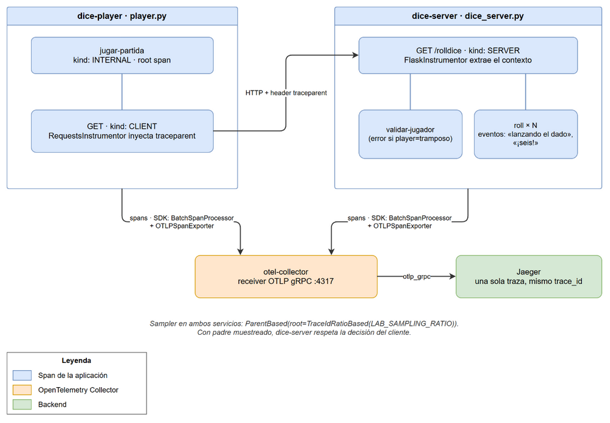

# {{ title }}



`RequestsInstrumentor` **inyecta** el contexto en el header `traceparent` y `FlaskInstrumentor` lo **extrae**: por eso ambos servicios comparten la traza.

:::step id="levantar" title="Levantar los dos servicios"
Terminal 1:

```bash
cd labs/lab04-trazas
python dice_server.py
```

Terminal 2:

```bash
cd labs/lab04-trazas
python player.py
```

- [ ] `player.py` juega 10 partidas y muestra `HTTP 200` y el `trace_id` de cada una.
:::

:::step id="jaeger" title="Explorar la traza distribuida"
En Jaeger (puerto 16686), elige el servicio `dice-player` y abre una traza `jugar-partida`.

- [ ] La traza tiene spans de **dos servicios** con el mismo Trace ID.
- [ ] El span `GET` de `dice-player` es de tipo **client** y `GET /rolldice` de `dice-server` es **server**, hijo del anterior.
- [ ] Los spans `roll` tienen los atributos `dice.roll.index` y `dice.roll.value` y el evento (*log*) `lanzando el dado`.
- [ ] En **Process** (el Resource) de cada servicio aparecen `service.name`, `service.version` y `service.instance.id`.
:::

:::step id="error" title="Registrar un error"
```bash
LAB_JUGADOR=tramposo LAB_PARTIDAS=1 python player.py
```

`dice_server.py` llama a `record_exception()` y `set_status(ERROR)` en el span `validar-jugador` y responde 403.

- [ ] En Jaeger, `validar-jugador` aparece con **error** y un evento `exception` (`exception.type`, `exception.message`).
- [ ] El span **server** `GET /rolldice` (HTTP 403) **no** está en error y el span **client** `GET` **sí**: es la regla de las convenciones HTTP, los 4xx dejan el estado sin definir en spans SERVER y lo marcan como Error en spans CLIENT ([HTTP spans](https://opentelemetry.io/docs/specs/semconv/http/http-spans/#status)).
:::

:::step id="sampling" title="Head sampling con ParentBased"
Ambos servicios usan `ParentBased(root=TraceIdRatioBased(LAB_SAMPLING_RATIO))`.

:::substep id="cliente50" title="El cliente muestrea el 50 %"
```bash
LAB_SAMPLING_RATIO=0.5 LAB_PARTIDAS=20 python player.py
```

- [ ] Alrededor de la mitad de las partidas dice `muestreada=True`, y solo esas aparecen en Jaeger.
- [ ] Para las partidas no muestreadas tampoco hay trazas de `dice-server`: respetó la decisión del padre (no quedaron trazas a medias).
:::

:::substep id="servidor0" title="El servidor con ratio 0"
Detén el servidor y reinícialo con `LAB_SAMPLING_RATIO=0.0 python dice_server.py`. Después:

```bash
python player.py                       # el cliente muestrea el 100 %
curl "localhost:8080/rolldice?rolls=2" # una request SIN padre
```

- [ ] Las partidas de `player.py` siguen apareciendo completas: con padre muestreado, `ParentBased` usa *AlwaysOn*.
- [ ] La request de `curl` (sin `traceparent`) **no** aparece: sin padre se aplica el sampler raíz con ratio 0.
:::
:::

:::step id="shutdown" title="Cerrar bien el proceso"
`player.py` termina con `provider.shutdown()` para vaciar el `BatchSpanProcessor` antes de salir. En Python el `TracerProvider` además registra un apagado automático al terminar el proceso (`shutdown_on_exit=True` por defecto), pero llamarlo explícitamente deja claro el comportamiento.

- [ ] Detuve `dice_server.py` con `Ctrl+C`.
:::
