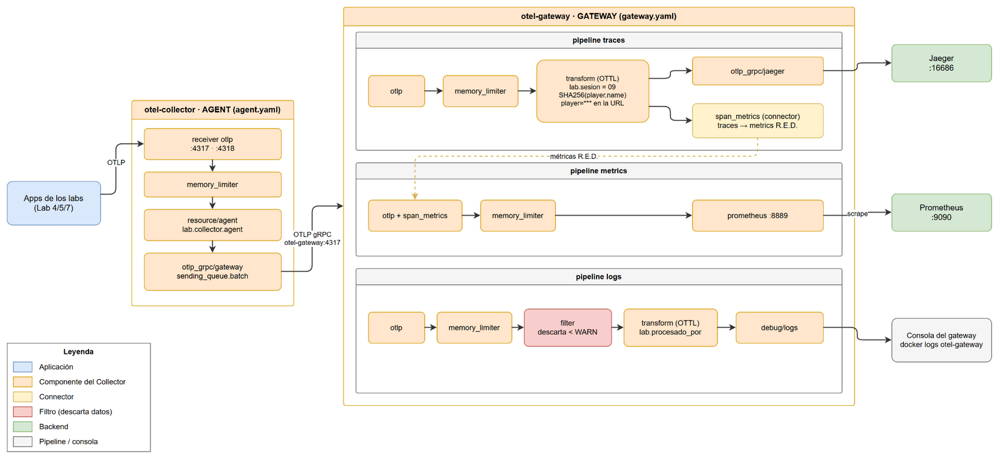

# {{ title }}



:::step id="leer" title="Leer las dos configuraciones"
Abre `labs/lab09-ottl-gateway/agent.yaml` y `gateway.yaml`.

- [ ] En el **agent**: el exporter `otlp_grpc/gateway` apunta a `otel-gateway:4317` y usa batching en el exporter (`sending_queue.batch`).
- [ ] En el **gateway**: el pipeline de `traces` exporta a `span_metrics` y el de `metrics` lo recibe (el connector une los dos pipelines).
- [ ] Puedo leer cada sentencia OTTL del `transform/enriquecer` y decir qué hace.
:::

:::step id="desplegar" title="Desplegar gateway y agent"
Primero el gateway (activa el perfil `gateway` del compose) y después el agent:

```bash
labs/lab-env/use-collector-config.sh labs/lab09-ottl-gateway/gateway.yaml gateway
labs/lab-env/use-collector-config.sh labs/lab09-ottl-gateway/agent.yaml
docker ps --format 'table {{.Names}}\t{{.Status}}'
```

- [ ] Están corriendo `otel-collector` (agent) y `otel-gateway`.
:::

:::step id="trafico" title="Generar tráfico"
```bash
# Terminal 1
cd labs/lab05-metricas && python dice_server.py
# Terminal 2
cd labs/lab04-trazas && LAB_PARTIDAS=30 python player.py
```

- [ ] `docker logs otel-collector 2>&1 | tail -5` (agent) muestra trazas y métricas recibidas.
- [ ] `docker logs otel-gateway 2>&1 | tail -5` no muestra errores.
:::

:::step id="ottl" title="Verificar las transformaciones OTTL"
En Jaeger, abre una traza reciente de `dice-player`.

- [ ] Todos los spans tienen el atributo `lab.sesion = 09` (`set`).
- [ ] `player.name` ya no muestra el nombre: es un hash SHA-256 (`SHA256` como converter dentro de `set`, solo `where` el atributo existe).
- [ ] En los spans HTTP, `http.target` o `http.url` muestran `player=***` (`replace_pattern`).
- [ ] El Process de las trazas incluye `lab.collector.agent = otel-collector`, que agregó el agent.
:::

:::step id="span-metrics" title="Métricas RED desde las trazas"
El connector `span_metrics` publica cada 15 s (`metrics_flush_interval`) llamadas y duración por servicio, span, tipo de span y estado ([README](https://github.com/open-telemetry/opentelemetry-collector-contrib/tree/main/connector/spanmetricsconnector)). En Prometheus escribe `traces_span` y elige:

```text
traces_span_metrics_calls_total
sum by (service_name, span_name) (rate(traces_span_metrics_calls_total[5m]))
```

- [ ] Hay series para `dice-player` y `dice-server`, con etiquetas `span_name`, `span_kind` y `status_code`.
- [ ] Veo también métricas de duración (`traces_span_metrics_duration…`): con llamadas, errores (por `status_code`) y duración tengo **R.E.D.** sin haber escrito ni una métrica en el código.
:::

:::step id="filter" title="Filtrar logs por severidad"
El gateway descarta los logs por debajo de WARN. Genera un log INFO (prueba de humo) y logs WARNING (la app del Lab 7). Detén antes el `dice_server.py` de la terminal 1 para liberar el puerto 8080:

```bash
# Terminal 1: app del Lab 7 (su log "… is rolling the dice" es WARNING)
cd "$(git rev-parse --show-toplevel)/labs/lab07-configuracion"
source otel.env && opentelemetry-instrument flask run -p 8080
# Terminal 2
cd "$(git rev-parse --show-toplevel)"
curl -s "localhost:8080/rolldice?player=ana"; echo
python labs/lab-env/smoke_test.py          # su log es INFO
sleep 5
docker logs otel-gateway 2>&1 | grep -c "SeverityText: INFO"
docker logs otel-gateway 2>&1 | grep -A8 "SeverityText: WARN"
```

- [ ] El conteo de logs INFO en el gateway es `0`; los WARNING sí llegan, con el atributo `lab.procesado_por = gateway`.
- [ ] Sé que en `filter` lo que **cumple** la condición se **descarta**.
:::

:::step id="cerrar" title="Volver al Collector del curso"
```bash
cd "$(git rev-parse --show-toplevel)" && labs/lab-env/reset-collector.sh
```

- [ ] El gateway se detuvo y `otel-collector` volvió a la configuración del curso.
- [ ] Detuve los servicios de las terminales 1 y 2.
:::
