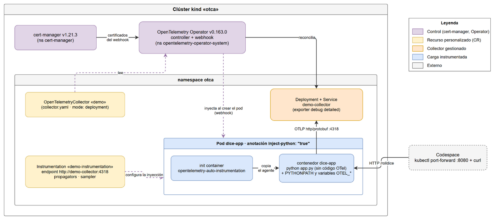

# {{ title }}

Versiones fijadas: kind **v0.33.0**, cert-manager **v1.21.3** y OpenTelemetry Operator **v0.163.0**. La app de `labs/lab10-kubernetes/app/` **no tiene código de OpenTelemetry**.



:::step id="cluster" title="Crear el clúster e instalar el Operator"
Libera recursos apagando el entorno del curso y crea el clúster:

```bash
labs/lab-env/down.sh
labs/lab10-kubernetes/cluster-up.sh
kubectl get pods -A
```

El script crea el clúster kind `otca`, instala **cert-manager** (el webhook del Operator necesita certificados), instala el **Operator** con su manifiesto oficial y crea el namespace `otca`.

- [ ] Los pods de `cert-manager` y `opentelemetry-operator-system` están `Running`.

> [!NOTE]
> Si más adelante un `kubectl apply` responde `failed calling webhook … connection refused`, el webhook del Operator todavía no está listo: espera unos segundos y repite. El script ya espera a que responda antes de terminar.
:::

:::step id="collector" title="Un Collector gestionado por el Operator"
```bash
cat labs/lab10-kubernetes/collector.yaml
kubectl apply -f labs/lab10-kubernetes/collector.yaml
kubectl get opentelemetrycollectors -n otca
kubectl get deploy,svc -n otca
```

- [ ] Existe el Deployment `demo-collector` y el Service `demo-collector` (nombre del recurso + `-collector`).
- [ ] Entiendo que la configuración del Collector vive en `spec.config` y que `mode: deployment` es el modo por defecto.
:::

:::step id="instrumentation" title="El recurso Instrumentation (antes que la app)"
```bash
kubectl apply -f labs/lab10-kubernetes/instrumentation.yaml
kubectl get instrumentations -n otca
```

- [ ] Existe `demo-instrumentation` con endpoint `http://demo-collector:4318`: la auto-instrumentación de Python usa `http/protobuf`, no gRPC.
:::

:::step id="app" title="Construir y desplegar la app anotada"
```bash
docker build -t dice-app:lab10 labs/lab10-kubernetes/app
kind load docker-image dice-app:lab10 --name otca
kubectl apply -f labs/lab10-kubernetes/app.yaml
kubectl rollout status deploy/dice-app -n otca
kubectl describe pod -n otca -l app=dice-app | grep -A3 "Init Containers"
kubectl get pod -n otca -l app=dice-app -o yaml | grep -E "name: (OTEL_|PYTHONPATH)" | sort -u
```

- [ ] El pod tiene un **init container** cuyo nombre empieza por `opentelemetry-auto-instrumentation`.
- [ ] Al contenedor de la app se le agregaron variables como `OTEL_SERVICE_NAME`, `OTEL_EXPORTER_OTLP_ENDPOINT`, `OTEL_RESOURCE_ATTRIBUTES` y `PYTHONPATH`.
:::

:::step id="trafico" title="Generar tráfico y ver los spans"
```bash
kubectl port-forward -n otca svc/dice-app 8080:8080 >/dev/null 2>&1 &
for i in $(seq 1 5); do curl -s "localhost:8080/rolldice?player=ana"; echo; done
sleep 10
kubectl logs -n otca deploy/demo-collector | grep -E "service.name|k8s\.|Name +:" | head -30
```

- [ ] Hay spans `GET /rolldice` aunque la app no tiene código de OpenTelemetry.
- [ ] `service.name` es `dice-app`: el Operator lo tomó del nombre del **Deployment** ([cómo se calcula](https://opentelemetry.io/docs/platforms/kubernetes/operator/automatic/#how-servicename-is-calculated)).
- [ ] El Resource incluye atributos de Kubernetes como `k8s.namespace.name` y `k8s.pod.name`.
:::

:::step id="resource" title="Cambiar service.name con una anotación"
```bash
kubectl patch deployment dice-app -n otca --type merge \
  -p '{"spec":{"template":{"metadata":{"annotations":{"resource.opentelemetry.io/service.name":"dice-k8s"}}}}}'
kubectl rollout status deploy/dice-app -n otca
```

Vuelve a lanzar el `port-forward` y el `curl` del paso anterior y revisa los logs del Collector.

- [ ] Los spans nuevos tienen `service.name: dice-k8s` (la anotación tiene prioridad sobre el nombre del Deployment).
:::

:::step id="escalar" title="Escalar el Collector"
```bash
kubectl patch opentelemetrycollector demo -n otca --type merge -p '{"spec":{"replicas":2}}'
kubectl get pods -n otca
```

- [ ] Hay dos pods `demo-collector-…`; el Service reparte el tráfico entre ellos.
- [ ] Sé que con `spec.autoscaler` el Operator crea un HPA (requiere Metrics Server, que kind no trae instalado) ([HPA](https://opentelemetry.io/docs/platforms/kubernetes/operator/horizontal-pod-autoscaling/)).
:::

:::step id="orden" title="(Opcional) El orden importa"
```bash
kubectl delete -f labs/lab10-kubernetes/instrumentation.yaml
kubectl rollout restart deploy/dice-app -n otca && kubectl rollout status deploy/dice-app -n otca
kubectl describe pod -n otca -l app=dice-app | grep -c "opentelemetry-auto-instrumentation"
kubectl apply -f labs/lab10-kubernetes/instrumentation.yaml
kubectl rollout restart deploy/dice-app -n otca
```

- [ ] Sin el recurso `Instrumentation`, los pods nuevos no reciben el init container (el conteo es 0); al recrearlo y reiniciar, vuelve.
:::

:::step id="limpiar" title="Limpiar"
```bash
kill %1 2>/dev/null
labs/lab10-kubernetes/cluster-down.sh
labs/lab-env/up.sh
```

- [ ] Eliminé el clúster y el entorno del curso volvió a estar `OK`.
:::
